<p align="center">
  
</p>

<h1 align="center">КСТ Визор</h1>

<p align="center">
  <a href="https://github.com/coder-smookki/AIst-CyberHack102/releases/latest"></a>
  <a href="https://github.com/coder-smookki/AIst-CyberHack102/releases/latest/download/KST-Vizor.apk"></a>
  
  <br>
  
  
  
  
  
  
  
  <a href="#запуск-в-docker"></a>
  
</p>

<p align="center">
  AR-помощник обходчика насосной станции: узнаёт агрегат по шильдику, показывает его карточку и параметры, в реальном времени находит узлы и внешние дефекты и записывает осмотр
</p>

Кейс компании КСТ ЭНЕРГО ИНЖИНИРИНГ, хакатон «Кибер 102», команда AIst.

<p align="center">
  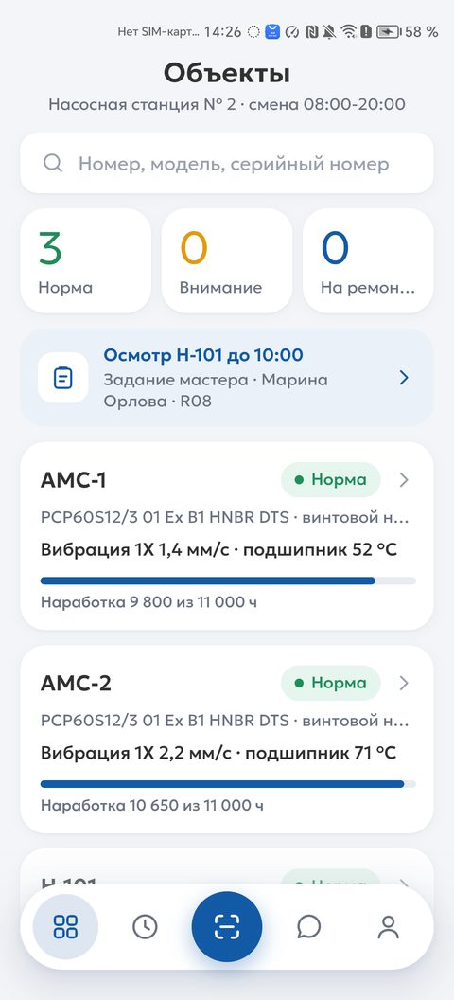
  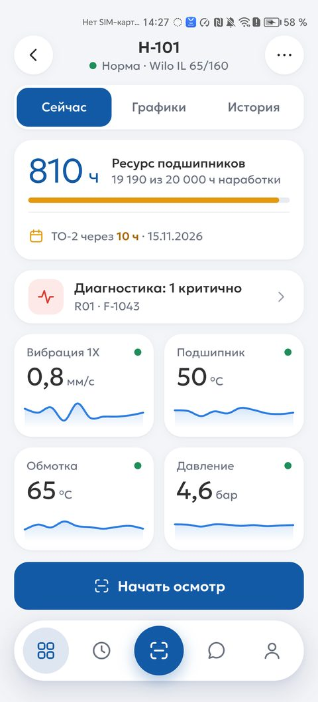
  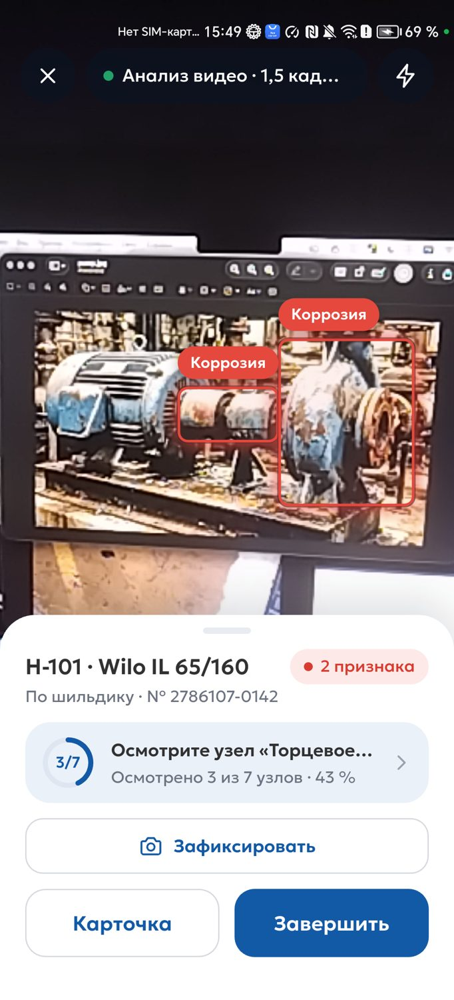
  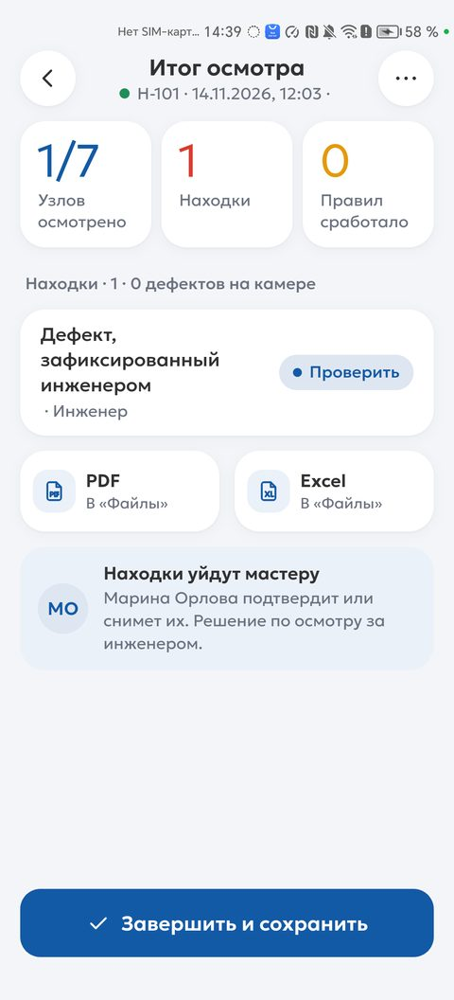
</p>

<p align="center">
  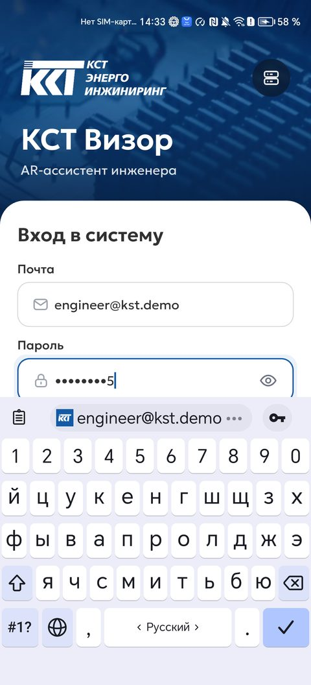
  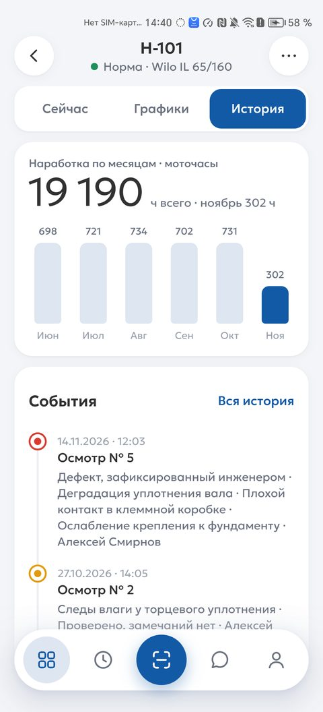
</p>

## Видео

<p align="center">
  <a href="https://github.com/coder-smookki/AIst-CyberHack102/releases/latest/download/AIst-Demo-Video.mp4">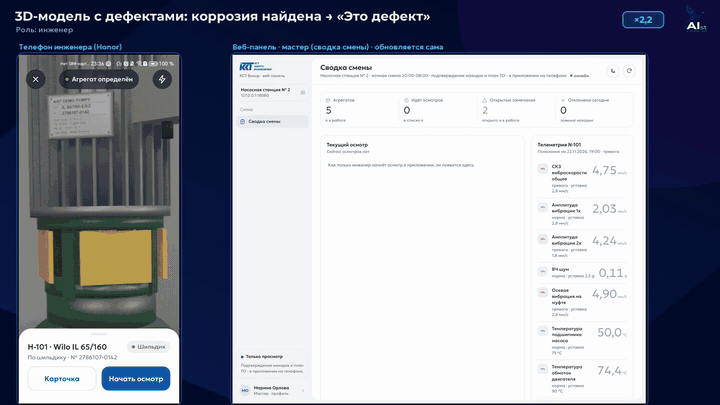</a>
</p>

<p align="center">
  <a href="https://github.com/coder-smookki/AIst-CyberHack102/releases/latest/download/AIst-Demo-Video.mp4"><b>Демонстрация, 3:00</b></a>: телефон и веб-панель одновременно - шильдик, карточка, осмотр, находки, шум, отчёт, ассистент без интернета, мастер, оператор, сценарий отказа от администратора, помощник веб-панели создаёт сотрудника по команде администратора ИБ<br>
  <a href="https://github.com/coder-smookki/AIst-CyberHack102/releases/latest/download/AIst-Benchmark-ModelCV-Video.mp4"><b>Прогон моделей, 1:09</b></a>: рамки на тестовых наборах и итоговая таблица точности
</p>

## Что где

| Что | Где |
|---|---|
| Приложение Android | [Последний релиз](https://github.com/coder-smookki/AIst-CyberHack102/releases/latest): `KST-Vizor.apk` (`arm64-v8a`) и его SHA-256 |
| Презентация и видео | В том же релизе: презентация `AIst-Presentation-Product` (PPTX и PDF), видео демонстрации `AIst-Demo-Video.mp4`, видео прогона моделей `AIst-Benchmark-ModelCV-Video.mp4` |
| Материалы для проверки | `Materials_for_testing.zip` в релизе: шильдики агрегатов и фото дефектов из открытых источников с авторами и лицензиями |
| Исходный код приложения | [mobile/](mobile): Flutter, Android и iOS из одного кода |
| Сервер и веб-панель | [server/](server): FastAPI; веб-панель и пульт на Next.js в [web/](web), адреса `/web/` и `/panel/`; прежняя версия без сборки - [server/webadmin/](server/webadmin), `/web-classic/` |
| Модели | [models/](models): `detector.onnx`, `defects.onnx`, описание, пороги и замеры в [models/models.json](models/models.json) |
| Данные | [data/DATASETS.txt](data/DATASETS.txt): источники, лицензии, объёмы, проверка повторов |
| Запуск | `docker compose up -d --build` в корне: [Запуск в Docker](#запуск-в-docker) |
| Сборка приложения | [.github/workflows/mobile.yml](.github/workflows/mobile.yml) |
| Демо-стенд | https://kct.lumnex.ru (открывается на https://kct-vizor.lumnex.ru:4433), веб-панель `/web/`, закрыт паролем сайта; логин и пароль - в описании решения на странице хакатона |

## Команда AIst

| Участник | Роль | GitHub |
|---|---|---|
| Ильин Кирилл | Разработчик, тимлид | [@coder-smookki](https://github.com/coder-smookki) |
| Васильева Арина | Дизайнер, QA-тестировщик | [@jfghmrr](https://github.com/jfghmrr) |

## Быстрый старт

1. Скачайте `KST-Vizor.apk` из [последнего релиза](https://github.com/coder-smookki/AIst-CyberHack102/releases/latest) и установите на Android 7.0 и новее (`arm64`)
2. Приложение уже подключено к демо-стенду https://kct-vizor.lumnex.ru:4433. Кнопка «Сервер» на экране входа задаёт адрес своего сервера цеха, без сервера приложение работает в «Демо-режиме» на встроенных данных
3. Войдите под одной из демо-учётных записей
4. iOS 16.4 и новее: приложение собирается из того же кода, см. [Сборка приложения](#сборка-приложения)

```sh
adb install -r KST-Vizor.apk
```

**Демо-учётные записи**, пароль у всех `demo12345`:

| Роль | Почта |
|---|---|
| Инженер | `engineer@kst.demo` |
| Мастер | `master@kst.demo` |
| Оператор | `operator@kst.demo` |
| Админ | `admin@kst.demo` |
| Админ ИБ | `security@kst.demo` |

APK подписан отладочным ключом сборки. Новая сборка из CI не обновит установленную поверх, сначала удалите старую.

## Задача и решение

**Проблема.** Обходчик проверяет насосные агрегаты по памяти и бумажным листам. Параметры датчиков, наработка, прошлые замечания и нормативы лежат в разных системах, а в цеху часто нет интернета. Внешние дефекты (коррозия, течь, подгорание клеммной коробки, снятый кожух муфты) легко пропустить, а записи осмотра потом сложно проверить.

**Решение.** Телефон и сервер в локальной сети цеха:

1. Инженер наводит камеру на шильдик. Сервер читает его и находит агрегат по серийному номеру или модели. Если подходят несколько агрегатов, приложение предлагает выбрать, а не угадывает. QR и ручной выбор остаются запасными путями
2. Открывается карточка: параметры датчиков рядом с уставками, графики, наработка, ТО, история осмотров
3. «Начать осмотр»: маршрут по узлам в порядке важности (прошлое замечание, датчик, ресурс, плановый осмотр)
4. Камера передаёт кадры на сервер по WebSocket, поверх видео рисуются рамки узлов и дефектов. Обход отмечает осмотренные узлы
5. Правила диагностики сводят камеру, пороги датчиков и остаточный ресурс в вывод с доказательствами
6. Инженер фиксирует находку кадром с камеры и решает сам: «Это дефект» или «Не дефект». Загрузки из галереи нет, автоматически ничего не записывается
7. Запись звука агрегата 2-30 с: уровень, спектр, тональные пики по оборотам, импульсный шум. Признаки звука - только кандидаты, их подтверждает инженер
8. Итог осмотра уходит мастеру: мастер подтверждает или отклоняет находки с комментарием. Отчёт PDF и Excel: способ опознания, обход узлов, все находки с кадрами и признаками, отклонённые отдельно, датчики с графиками за 24 часа и 7 дней, звук со спектром, рекомендации, следующее ТО, подписи
9. Веб-панель обновляется сама: осмотры, находки, входы и события появляются там в реальном времени
10. Помощник веб-панели понимает команды обычным текстом: «заведи Соколову Ирину инженером», «включи перегрев обмоток на Н-101», «сводка смены». Он показывает план, выполняет его только после подтверждения и только с правами вошедшего пользователя, каждое действие попадает в журнал безопасности. Языковой модели и обращений в сеть нет: команда, которую помощник не понял, не выполняется

Демо-станция: насосы АМС-1, АМС-2, Н-101, шкаф управления ШУ-3 и силовой трансформатор ТР-1, у каждого свой шильдик и карточка.

## Роли

Права хранятся в базе и проверяются сервером на каждом запросе. Админ ИБ меняет матрицу прав, но сервер не даст оставить систему без единого активного сотрудника с правом управлять пользователями и ролями.

| Роль | Что может |
|---|---|
| **Инженер** | Объекты смены, поиск, карточка агрегата с параметрами, графиками и историей, распознавание шильдика, осмотр с камерой, маршрут и покрытие узлов, фиксация находок, диагностика по правилам, итог, отчёт PDF и Excel, задания от мастера, помощник |
| **Мастер** | Всё, что инженер, плюс сводка смены, подтверждение находок, план обслуживания, назначение осмотров, режим агрегата, управление телеметрией, отчёты всех инженеров |
| **Оператор** | Просмотр объектов, параметров и находок, сообщение о неисправности с кадром камеры, лента событий, помощник |
| **Админ** | Состояние системы и сервера, реестр оборудования, сценарии телеметрии и курсор времени для демонстрации, модели распознавания и замер скорости, журнал событий, резервные копии базы |
| **Админ ИБ** | Пользователи и сессии, временные пароли, блокировка с причиной, роли и матрица прав, журнал безопасности с фильтрами и выгрузкой CSV, политика паролей, блокировок и сессий. Доступа к оборудованию у этой роли нет |

Цепочка работы: оператор сообщает о неисправности, мастер назначает задание инженеру, инженер завершает осмотр этого агрегата, задание закрывается, уведомления строятся из заданий и сообщений.

<p align="center">
  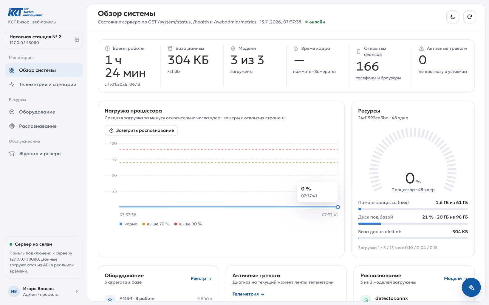
</p>

<p align="center">
  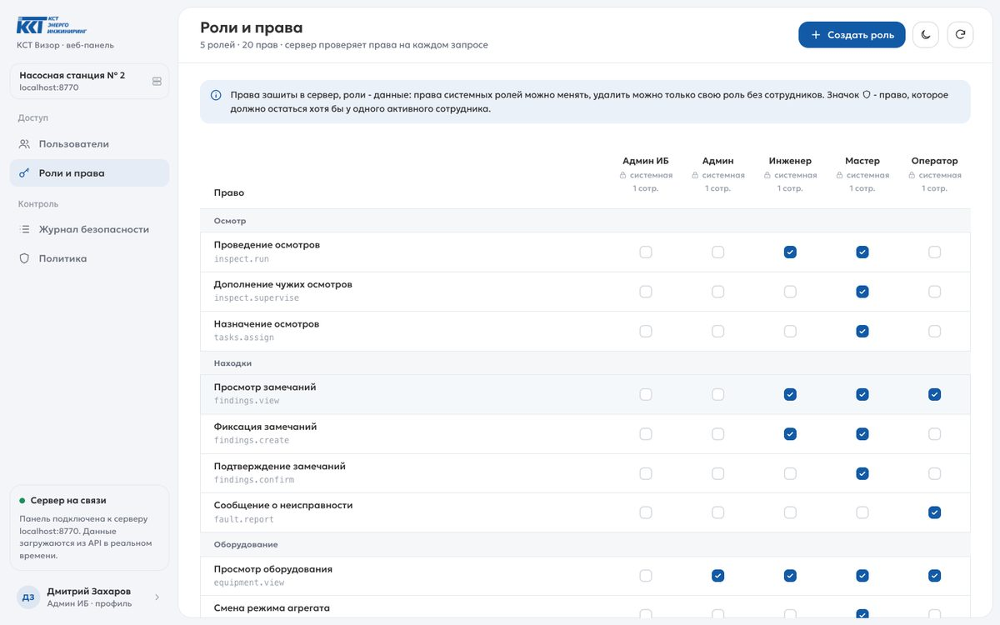
</p>

## Как устроено

```text
Телефон (Flutter, Android и iOS)
  камера -> JPEG в отдельном потоке -> до двух кадров в обработке
  |                                   ^
  | WebSocket /ws/inspect/{id}        | рамки, статусы, покрытие узлов, подсказка
  v                                   |
Сервер цеха (FastAPI, Docker)
  распознавание  detector.onnx (узлы) + defects.onnx (дефекты), ONNX Runtime на CPU
  шильдик        RapidOCR, поиск серийных номеров и моделей реестра в тексте
  манометр       поиск циферблата и стрелки классическим CV, шкала из карточки
  телеметрия     базы заказчика без изменений + смоделированные каналы и сценарии отказов
  правила        26 правил: R01-R12 заказчика, S01-S05 уставки, V01 камера, N01 звук,
                 C01-C03 шкаф, T01-T04 трансформатор; нехватка данных = «Недостаточно данных»
  звук           анализ WAV: уровень, спектр, пики по оборотам, импульсный шум
  осмотры        маршрут, покрытие, находки с кадром, отчёты PDF и Excel
  доступ         scrypt, JWT с ротацией refresh, роли и права в базе
  |
  +--> SQLite: пользователи, оборудование, осмотры, журналы
  |
  v
Веб-панель /web/ и пульт /panel/ (Next.js, статическая сборка внутри того же контейнера, без CDN)
  Админ ИБ, Админ, сводка Мастера, помощник с подтверждением действий; обновляется сама за 1-2 секунды
```

| Компонент | Что делает |
|---|---|
| `mobile/` | Приложение: вход с биометрией, роли, камера и AR-рамки, карточки, графики, осмотр, отчёты, помощник. Работает с сервером или в «Демо-режиме» |
| `mobile/lib/core/llm` | Помощник на телефоне: поиск по встроенной справке, при достаточной памяти локальная языковая модель через llama.cpp |
| `server/` | API, распознавание по WebSocket, телеметрия, правила, осмотры, отчёты, роли и права, журнал безопасности |
| `server/webadmin/` | Веб-панель администраторов |
| `cv/` | Обучение, экспорт, оценка моделей, чтение шильдика и манометра, сборщики наборов данных |
| `blender/` | Параметрическая сцена насосного агрегата и автоматическая разметка рендеров |
| `Dockerfile`, `docker-compose.yml` | Образ сервера вместе с веб-панелью и запуск одной командой |

Распознавание идёт на сервере, а не на телефоне: заказчик допускает локальный сервер, один путь для iOS и Android, модели меняются без пересборки приложения.

**Статусы рамок.** Дефект с уверенностью от 0,5 - красный «дефект». Ниже, но не ниже порога модели - жёлтый «проверить», такие рамки не скрываются: по словам заказчика, пропущенный дефект хуже ложной тревоги. Узлы, которых камера ещё не видела, остаются серыми.

## Стек

| Часть | Версии |
|---|---|
| Приложение | Flutter 3.44.7, Dart 3.12.2, flutter_riverpod 3.3.2, go_router 17.3.0, camera 0.12.2, http 1.6.0, web_socket_channel 3.0.3, llamadart 0.19.9 (llama.cpp) |
| Сервер | Python 3.11, FastAPI 0.162.7, Starlette 1.10.0, Uvicorn 0.54.0, SQLAlchemy 2.1.8 и SQLite, PyJWT 2.15.1, reportlab 5.1.0, openpyxl 3.1.5 |
| Распознавание | ONNX Runtime 1.32.0, libreyolo 1.7.4, RapidOCR 3.10.0, OpenCV 5.0.0.93, NumPy 2.4.6 |
| Данные для обучения | Blender 5.2 LTS, GPU Kaggle |
| Развёртывание | Docker и Compose, Caddy 2.10.2, nginx с TLS на входе |
| CI | GitHub Actions: APK на Ubuntu, IPA на macOS |

## Модели

| Назначение | Модель | Вход | Размер | Лицензия весов |
|---|---|---:|---:|---|
| Узлы агрегата | LibreYOLO9t, 11 классов | 640 px | 8,4 МБ | MIT |
| Внешние дефекты | RF-DETR nano (LibreRFDETRn), 4 класса, int8 | 384 px | 33,6 МБ | Apache-2.0 |
| Текст шильдика | RapidOCR, модели PP-OCR | | | Apache-2.0 |
| Помощник на телефоне | Qwen3-0.6B GGUF, Q8_0 и Q4_K_M | | 639 и 397 МБ | Apache-2.0 |

Узлы: `motor`, `pump_casing`, `flange`, `coupling_guard`, `coupling_no_guard`, `terminal_box`, `terminal_box_burnt`, `nameplate`, `gauge`, `leak`, `corrosion`. Дефекты: `corrosion`, `leak`, `terminal_box_burnt`, `damage` (трещина, излом, повреждение изоляции). Код обучения и вывода тоже под MIT и Apache-2.0: Ultralytics не используется, потому что её код и веса под AGPL-3.0.

Пороги сервера: узлы 0,25, дефекты 0,15. Модели узлов и дефектов работают вместе, рамки объединяются.

**Прогон моделей на видео.** `AIst-Benchmark-ModelCV-Video.mp4` в релизе: обе модели на тестовых наборах (рендеры 3D-модели, реальные фото узлов, фото дефектов из открытых источников, шильдики) с рамками на каждом кадре и итоговой таблицей, все числа посчитаны этим прогоном.

**Замеры.** Строки «как на сервере» - из [models/models.json](models/models.json): исходные снимки, единый порог модели дефектов 0,15 (до порогов по классам). Строки «как в поставке» - прогон 14.11.2026 с порогами по классам из того же файла на кадрах, ужатых до 720 px и JPEG 80, как их отправляет приложение (видео `AIst-Benchmark-ModelCV-Video.mp4` в релизе). Рамка верна при совпадении класса и пересечении от 0,5. Ни один из наборов ниже не участвовал в обучении и выборе модели.

| Модель | Набор | Результат |
|---|---|---|
| Узлы | Тест рендеров, 70 кадров, порог 0,25 | точность 0,939, полнота 0,992, mAP50 0,981 |
| Узлы | Реальные снимки узлов, 42 снимка, порог 0,25 | точность 0,952, полнота 0,909, mAP50 0,600 |
| Узлы | Прежняя модель только на рендерах, те же 42 снимка | точность 0,185, полнота 0,114, mAP50 0,104 |
| Обе модели, как на сервере | Отложенные снимки заказчика, 8; исходные снимки, единый порог 0,15 | точность рамок 0,625, полнота 0,556, дефект найден на 6 из 8, верный класс на 0,625 снимков, mAP50 0,417 |
| Обе модели, как в поставке | Те же 8 снимков; кадр 720 px, JPEG 80, пороги по классам | точность рамок 0,50 (5 верных, 5 лишних, 4 пропущено), полнота 0,556 |
| Обе модели, как на сервере | Те же снимки, 40 копий с имитацией съёмки монитора | дефект найден на 0,90 снимков, точность рамок 0,279, полнота 0,422 |
| Обе модели, как на сервере | Снимки из сети, 46 с дефектами и 29 чистых; исходные снимки, единый порог 0,15 | дефект найден на 0,891, верный класс на 0,674, ложная тревога на 0,138 чистых |
| Обе модели, как в поставке | Те же снимки; кадр 720 px, JPEG 80, пороги по классам | дефект найден на 38 из 46 (0,826), верный класс на 29 из 46 (0,630), ложная тревога на 4 из 29 чистых (0,138), красных рамок на чистых нет |
| Обе модели, как на сервере | Проверочная часть, 519 кадров | точность рамок 0,426, полнота 0,691, mAP50 0,675 |

| Скорость | Значение | Условия |
|---|---:|---|
| Модель узлов | 40 мс | ONNX Runtime на CPU, 640 px; повторный замер под нагрузкой других задач 75 мс |
| Модель дефектов | 80 мс | ONNX Runtime на CPU Apple M4 под нагрузкой других задач, 384 px |
| Кадр туда и обратно через `/ws/detect` | медиана 171 мс, p90 188 мс | обе модели, сервер на M4, кадры 1280 px, около 6 кадров в секунду |

<p align="center">
  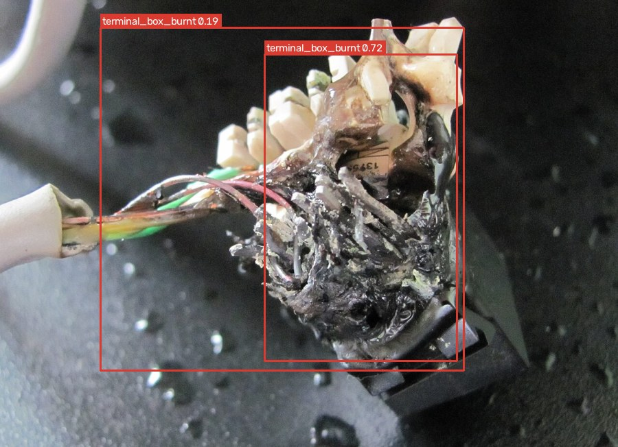
  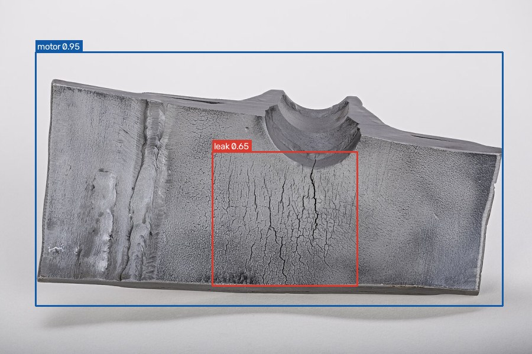
  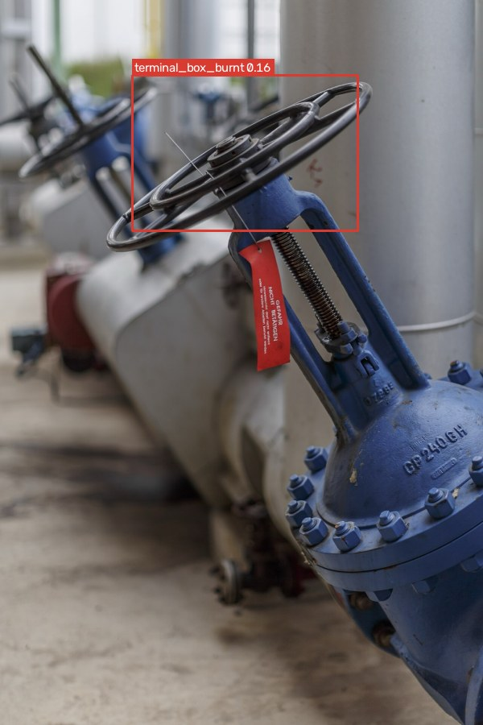
</p>

Слева направо: подгоревшие контакты найдены; трещина найдена, но названа течью; ложная тревога на исправной задвижке. Снимки из тестового набора, Wikimedia Commons, CC BY-SA 3.0: [Gabriel Acquistapace](https://commons.wikimedia.org/wiki/File:Short_circuit_by_water_RJ45_PoE.JPG), [CEphoto, Uwe Aranas](https://commons.wikimedia.org/wiki/File:Stress-Corrosion-Cracking-caused-by-weld-stress-01.jpg), [CEphoto, Uwe Aranas](https://commons.wikimedia.org/wiki/File:Cologne_Germany_Closed_Gate-Valve-01.jpg).

## Данные

Подробно, с адресами и лицензиями каждого источника, в [data/DATASETS.txt](data/DATASETS.txt). Сами данные в репозиторий не входят.

| Набор | Что это | Для чего |
|---|---|---|
| Рендеры Blender | Собственная сцена насосного агрегата, разметка при рендере: обучение 296, проверка 50, тест 70 | Модель узлов, замер шильдика и манометра |
| Снимки заказчика | 54 файла, размечено 38 снимков, 54 рамки. 8 снимков отложены и в обучение не попадали ни в каком виде | Модель дефектов, копии «с монитора» для демонстрации на экране |
| Реальные снимки узлов | Roboflow electric-motor-housing (CC BY 4.0), Wikimedia Commons (CC0, PD, CC BY, CC BY-SA), снимки заказчика: обучение 136, тест 42 | Модель узлов |
| Сборка дефектов v3 | Ostrava corrosion (CC BY 4.0), corrosion-bi3q3 (CC BY 4.0), SAFE-Net (GPL), Corrosion Condition State (CC0), наборы Roboflow и Kaggle по коррозии, течам, подгоревшим контактам, трубам и изоляции: обучение 4908 и 1800 экранных копий, проверка 519 | Модель дефектов |
| Тестовый набор из сети | 90 снимков Wikimedia Commons, Zenodo и Mendeley Data, лицензия у каждого своя | Только проверка: доля найденных дефектов и ложных тревог |

- Каждый обучающий кадр сравнён с защищёнными снимками (отложенные снимки заказчика, их копии, тест из сети, тест узлов) по pHash и dHash, с кадрированиями и отражениями. Совпадения выброшены, пограничные пары просмотрены глазами
- Снимки заказчика на Kaggle загружались в закрытый набор с разрешения заказчика. Отложенные снимки и тест из сети на Kaggle не загружались, все замеры считались локально
- Часть открытых наборов (SAFE-Net под GPL, снимки Roboflow и Kaggle из сети) пригодна только для прототипа
- Четвёртая сборка дефектов (9422 кадра) и наборы для следующего круга модели узлов (манометры, шильдики, фланцы) собраны, но в поставку пока не входят

## Запуск в Docker

Всё серверное решение - API, распознавание (обе модели и чтение шильдиков), правила, отчёты, веб-панель `/web/` и пульт демонстрации `/panel/` - собирается в один контейнер. Нужен Docker с плагином `compose`.

```sh
git clone https://github.com/coder-smookki/AIst-CyberHack102.git
cd AIst-CyberHack102
docker compose up -d --build
docker compose ps        # статус healthy - сервер готов
```

- Веб-панель: http://localhost:8765/web/, пульт демонстрации: http://localhost:8765/panel/, проверка: http://localhost:8765/health
- Демо-учётные записи создаются при первом запуске, пароль у всех `demo12345`
- Телефон: на экране входа кнопка «Сервер», адрес `http://<IP компьютера>:8765`, телефон и компьютер в одной сети
- База, ключ подписи токенов и резервные копии лежат в томе `kst-runtime` и переживают пересборку
- Телеметрия заказчика в репозиторий не входит: положите `data/customer/Вибрация/*.xlsx` и `data/customer/Температура/*.xlsx` до сборки. Без них сервер запускается, но показания датчиков и графики недоступны
- Модели распознавания текста берутся из пакета `rapidocr` внутри образа, интернет нужен только для сборки
- Остановить: `docker compose down`, журнал: `docker compose logs -f app`

Без Docker: `python3.11 -m venv .venv && .venv/bin/pip install -r requirements.txt && .venv/bin/python -m server --port 8765`.

## Демо-стенд

Стенд работает на том же образе, что собирает `docker compose up -d --build`.

- Перед сервером стоит Caddy: к серверу пропускает только после пароля сайта. После входа ставится cookie, чтобы веб-панель и WebSocket работали без повторного пароля. Приложение проходит по ключу приложения в заголовке
- Ключ cookie и ключ приложения создаются на сервере при первом запуске и в репозиторий не попадают
- TLS завершается на входном nginx
- Контейнер приложения работает не от root, с лимитами CPU и памяти, проверкой здоровья и ротацией журналов

## Сборка приложения

Нужны Flutter 3.44.7, JDK 21, Android SDK 36 с NDK 28.2.13676358, для iOS - Xcode и macOS.

```sh
cd mobile
flutter pub get
python3 tool/fetch_llm.py download --repo Qwen/Qwen3-0.6B-GGUF --file Qwen3-0.6B-Q8_0.gguf \
  --id kv-main --title "Основная модель" --min-ram 7000 --min-ios-avail 3000 --context 2048 --snippets 3
flutter build apk --release --split-per-abi --target-platform android-arm64 --dart-define=KST_APP_KEY=<ключ>
flutter build ios --release --no-codesign --dart-define=KST_APP_KEY=<ключ>
```

- Веса языковой модели большие и в git не входят. Без них помощник отвечает поиском по справке. `python3 tool/fetch_llm.py list` показывает, какие уровни модели лежат в сборке
- Телефоны и планшеты Android и iOS собираются из одного кода. На планшете содержимое держится в центральной колонке, во время съёмки осмотра экран остаётся в книжной ориентации
- В приложении есть раздел «Как пользоваться»: что значит каждая рамка и кнопка, порядок осмотра, отдельная часть для каждой роли. Он открывается с экрана входа и из профиля
- `KST_APP_KEY` нужен только для сервера за паролем сайта. Для локального сервера и «Демо-режима» его можно не задавать

**CI.** [mobile.yml](.github/workflows/mobile.yml) собирает APK `arm64-v8a` на Ubuntu и IPA без подписи на macOS:

| Событие | Что получается |
|---|---|
| Push в `main` | APK `arm64-v8a` и IPA в артефактах запуска на 7 дней, без весов модели |
| Ручной запуск | То же, галочка `with_llm` добавляет веса модели |
| Тег `v*` | APK `arm64-v8a`, универсальный APK и IPA с весами модели в GitHub Release, рядом SHA-256 |

## Проверка качества

```sh
.venv/bin/ruff check .          # правила E, F, W, I, B, UP, SIM, RUF
.venv/bin/black --check .       # единый формат, строка до 130 знаков
.venv/bin/mypy                  # типы серверного кода
.venv/bin/python -m pytest -q   # тесты сервера
cd mobile && flutter analyze && flutter test
```

- Настройки `ruff`, `black` и `mypy` лежат в [pyproject.toml](pyproject.toml), те же проверки запускает [.pre-commit-config.yaml](.pre-commit-config.yaml) перед коммитом и [quality.yml](.github/workflows/quality.yml) в CI
- Тесты сервера покрывают правила на всей таблице заказчика, роли и права, осмотр, отчёты, помощника веб-панели и работу без обращений к внешним адресам
- Тесты приложения проходят 34 основных экрана на размерах телефона и планшета от 360×640 до 1366×1024 в обеих ориентациях и падают при любом выходе содержимого за край

## Сценарий проверки

Перед началом: сервер запущен, приложение установлено и подключено к серверу.

1. Войдите как `engineer@kst.demo`: открываются «Объекты» с агрегатами станции и заданием мастера
2. Нажмите центральную кнопку и наведите камеру на шильдик агрегата: открывается его карточка. Без шильдика агрегат выбирается из списка
3. В карточке на вкладке «Сейчас» параметры датчиков рядом с уставками, ресурс подшипников и срок ТО, на вкладках «Графики» и «История» - тренды и прошлые осмотры
4. Нажмите «Начать осмотр» и обойдите агрегат: поверх видео появляются рамки узлов и дефектов, счётчик осмотренных узлов растёт
5. Нажмите «Зафиксировать»: находка сохраняется с кадром камеры
6. Нажмите «Завершить»: итог осмотра с узлами, находками и сработавшими правилами, выгрузка PDF и Excel
7. Войдите в веб-панель как `security@kst.demo`: создайте пользователя, выдайте временный пароль, снимите право у роли и посмотрите, как сервер не даёт отнять последнее право управления ролями
8. Войдите в веб-панель как `admin@kst.demo`: включите сценарий отказа в телеметрии и сдвиньте курсор времени. Карточка агрегата на телефоне покажет изменившиеся параметры

## Ограничения

- Распознавание идёт на сервере, телефону нужна сеть цеха. Без сервера доступен только «Демо-режим»
- Модель узлов уверенно находит двигатели и манометры. Клеммные коробки, шильдики и муфты на реальных снимках почти не размечены, качество по ним не подтверждено
- Подгорание клеммной коробки на снимках заказчика не находится: открытых снимков клеммных коробок двигателей нет, в обучении бытовые розетки
- Отложенных снимков заказчика всего 8, числа по ним приблизительные. Съёмка экрана телефоном не замерялась, только её имитация
- На обстановке, не похожей на насосную, бывают ложные рамки
- Шильдик читается надёжно, только когда он крупно в кадре. Манометр отказывается от показания при сильном наклоне и слабом контрасте, а не угадывает
- Языковая модель на телефоне работает только на `arm64` и при памяти от 3 ГБ, иначе помощник отвечает поиском по справке
- IPA собран без подписи. APK подписан отладочным ключом CI

## Что дальше

1. Модель дефектов на четвёртой сборке данных и новый круг модели узлов на снимках манометров, шильдиков и фланцев
2. Настоящие снимки клеммных коробок и муфт с объектов заказчика для дообучения
3. Распознавание типа оборудования (двигатель, насос, шкаф, трансформатор) и новых видов дефектов: последствия пожара и замыкания, отсутствующие и сломанные детали
4. Подпись сборок ключом команды, публикация в магазины приложений
5. Ускорение сервера: настройка потоков ONNX Runtime и запуск моделей на GPU, если он есть на объекте
